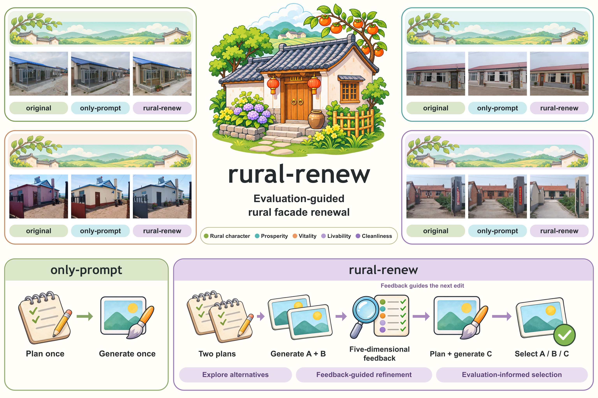
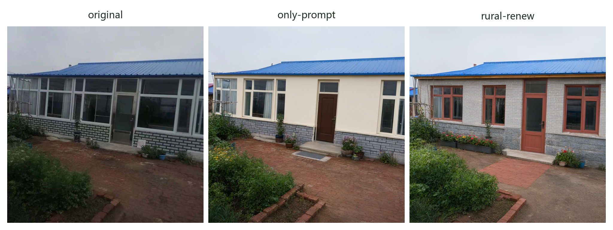
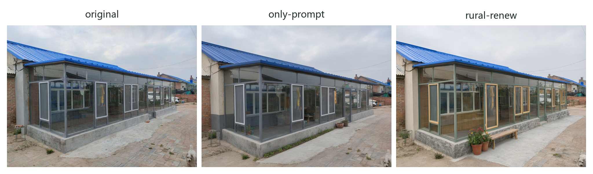
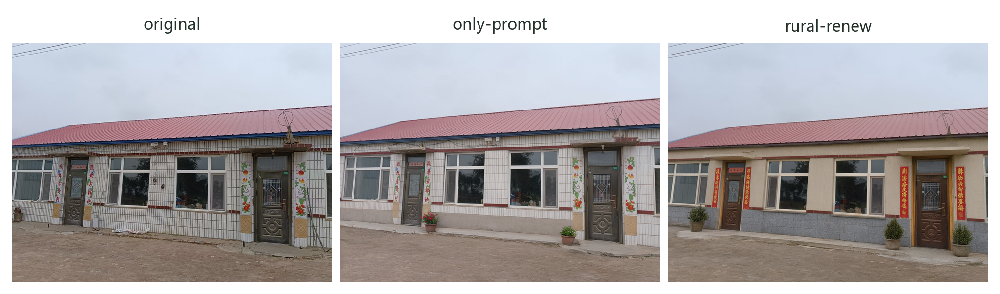
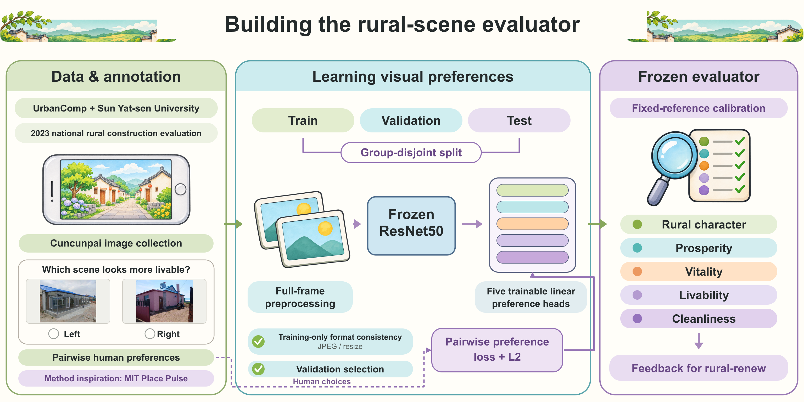

<p align="center">
  
</p>

<h1 align="center">rural-renew</h1>

[English](README.md) · [简体中文](README_zh.md)

## Overview

An agent workflow for rural-scene renewal that connects visual planning, image editing, and five-dimensional evaluation. It develops two initial proposals, uses their evaluation feedback to plan a third, and selects an edited result.



## Contributions

- Feedback-guided renewal: explore distinct designs, use five-dimensional feedback to guide revisions, and select an evaluated candidate.
- Five-dimensional scoring: build a rural-scene evaluator from pairwise perceptual judgments, covering rural character, prosperity, vitality, livability, and cleanliness to support consistent comparison and refinement.
- Quantitative improvement: across all 40 evaluated scenes, rural-renew achieves a mean weighted evaluation score 2.23 points higher than the single-generation only-prompt baseline.

## Selected examples

Each row shows the original photograph, the single-generation `only-prompt` result, and the result selected by `rural-renew`.







[View all 11 selected comparisons](assets/gallery.md)

## How it works

1. Propose two distinct renewal plans from the original photograph and optional location context.
2. Generate one candidate for each plan and evaluate rural character, prosperity, vitality, livability, and cleanliness.
3. Review the candidate images, their plans, and the differences in their evaluations to write a third proposal.
4. Generate and evaluate the third candidate, then ask the agent to select an edited result.

Every candidate is edited from the same original photograph. The selection prompt instructs the agent to choose the highest weighted evaluation, with earlier candidates winning ties. The runner preserves the agent's actual valid choice. The original photograph is excluded from the eligible outputs.

| Workflow | Agent calls | Image generations | Evaluation feedback |
|---|---:|---:|---|
| `only-prompt` | 1 | 1 | — |
| `rural-renew` | 3 | 3 | Guides the third proposal and final selection |

The gallery compares these two complete workflows. The prompt templates retain the original Chinese used for the examples.

## Quick start

Run these commands from the repository directory. Install the Python dependencies and [Codex CLI](https://learn.chatgpt.com/docs/codex/cli), then [sign in](https://learn.chatgpt.com/docs/auth):

```bash
python -m pip install -r requirements.txt
npm install -g @openai/codex@0.146.1
codex login
```

Set the image service credential in your shell:

```bash
export QWEN_API_KEY="your-api-key"
```

In PowerShell, use `$env:QWEN_API_KEY = "your-api-key"`. The runner reads the environment variable directly; it does not automatically load a `.env` file.

Review [config.example.json](config.example.json) before running. The example configuration records `gpt-5.6-sol` with medium reasoning for planning and `qwen-image-3.0-pro` for image editing. Set model IDs available to your account and a compatible image-service endpoint. Use `--config path/to/config.json` for your own configuration. The planner adapter was checked against Codex CLI 0.146.1.

Run rural-renew on an example photograph:

```bash
python run.py --image assets/original/F03.png --group rural-renew --output outputs/F03-rural-renew
```

Run the single-generation baseline:

```bash
python run.py --image assets/original/F03.png --group only-prompt --output outputs/F03-only-prompt
```

Each run writes `selected.png`, its candidate images, plans, and `result.json` to a new output directory. Choose an unused directory for each run. These commands call the configured model services. A service error stops the run and preserves completed files; it does not trigger an automatic retry.

Optional arguments: `--seed` sets the first generation seed; `--metadata` accepts a JSON file with `imageProv`, `imageCity`, `imageCounty`, `imageTown`, and `imageYear` for location context.

## Repository

| Directory | Contents |
|---|---|
| [`assets/`](assets/) | 40 original photographs, generated results for the 11 selected scenes, comparison panels, and the overview |
| [`prompts/`](prompts/) | Single-generation planning, dual proposals, feedback revision, selection, and structured output schemas |
| [`core/`](core/) | Workflow orchestration and the planner/image-editor adapters |
| [`eval_model/`](eval_model/) | Five-dimensional inference, learned heads, fixed reference data, and normalization |

## Evaluation model



The research background is the village-scene evaluation work of the UrbanComp team at China University of Geosciences (Wuhan) and collaborators at Sun Yat-sen University. Their work, undertaken in connection with the 2023 national rural construction evaluation initiative, combined crowdsourced photographs from the Cuncunpai platform with human pairwise judgments. See the [UrbanComp project introduction](https://urbancomp.net/archives/intelligent-interpretation-of-chinese-village). Our pairwise perceptual annotation approach draws on [MIT Place Pulse](https://www.media.mit.edu/projects/place-pulse-new/overview/).

The available five-dimensional labels include rural character alongside prosperity, vitality, livability, and cleanliness. The current evaluator keeps the [ResNet50 backbone](https://docs.pytorch.org/vision/stable/models/generated/torchvision.models.resnet50.html) frozen and trains five linear preference heads, then uses fixed training references and per-dimension standardization to produce feedback. The learned heads, reference data, and preprocessing are included; torchvision downloads the fixed ImageNet backbone on first use if needed. See the [construction and inference documentation](eval_model/README.md) for details.

