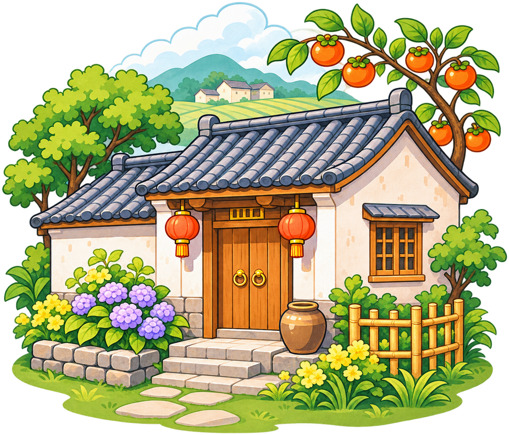
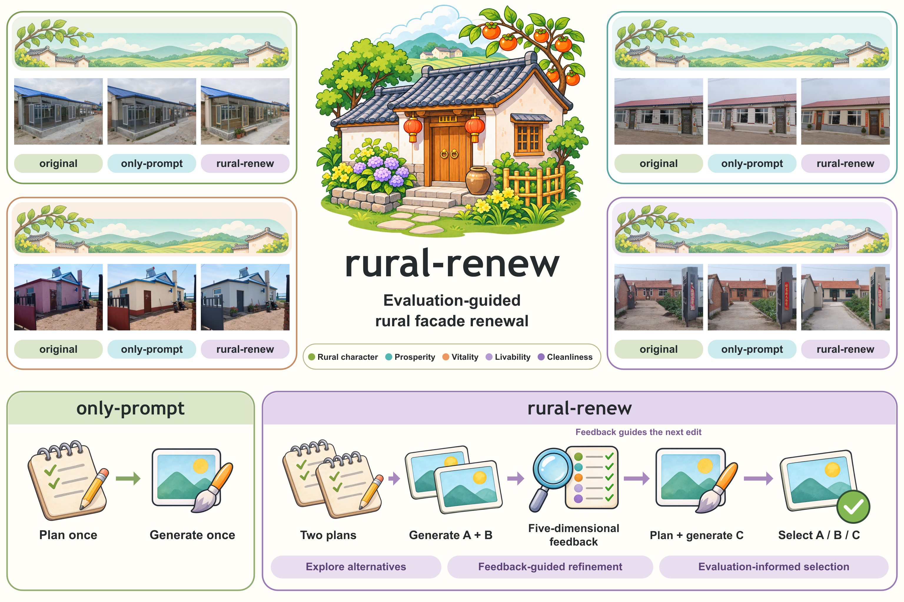
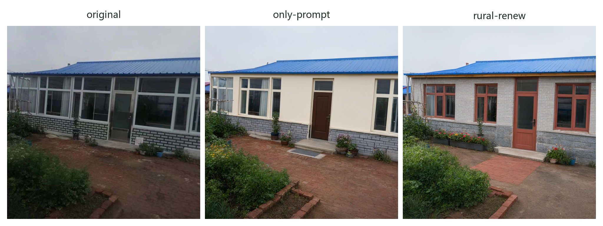
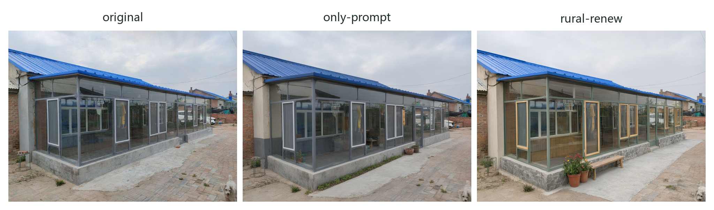
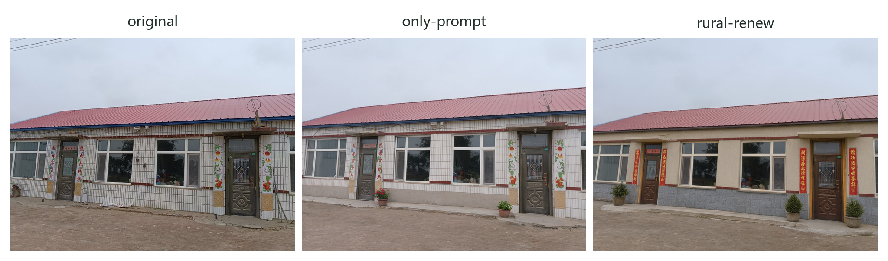
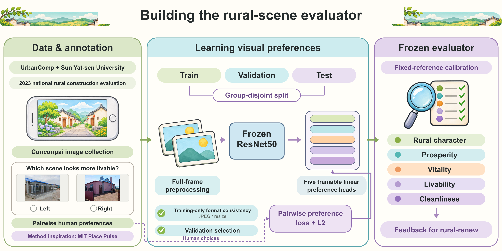

<p align="center">
  
</p>

<h1 align="center">rural-renew</h1>

[English](README.md) · [简体中文](README_zh.md)

## 概述

面向村景更新的 Agent 流程，将图像规划、图像编辑与五维评价结合起来。先提出两个改造方案，再根据评价反馈制定第三个方案，最后选出一张修改图。



## 主要贡献

- 评分驱动的方案优化：探索不同改造方案，利用五维反馈确定修订方向，并依据评价选择最终结果。
- 五维村景评分器：基于成对感知标注，构建覆盖乡土性、富裕、活力、宜居、整洁的评价模型，为方案比较和迭代提供统一反馈。
- 对照结果：在全部 40 个评估场景中，rural-renew 的加权综合评价分数平均比单次生成的 only-prompt 高 2.23 分。

## 精选案例

每行依次展示原图、单次生成的 `only-prompt` 结果，以及 `rural-renew` 流程选出的结果。







[查看全部 11 组精选对照](assets/gallery.md)

## 方法流程

1. 根据原图和可选的地区信息，提出两个不同的村景改造方案。
2. 分别生成两张候选图，评价其乡土性、富裕、活力、宜居和整洁五个维度。
3. 结合候选图、已有方案及五维评价差异，制定第三个方案。
4. 生成并评价第三张候选图，再由 Agent 选择最终修改图。

所有候选都从同一张原图编辑。最终选择提示词要求 Agent 选择加权评价最高的候选，并在同分时优先选择较早生成的候选；程序保留 Agent 实际给出的有效选择。原图不属于可选输出。

| 流程 | Agent 调用 | 图像生成 | 评价反馈 |
|---|---:|---:|---|
| `only-prompt` | 1 次 | 1 次 | — |
| `rural-renew` | 3 次 | 3 次 | 指导第三个方案和最终选择 |

案例展示对比的是这两套完整流程。提示词模板保留了生成案例时使用的中文原文。

## 快速开始

在仓库目录中执行以下命令，安装 Python 依赖和 [Codex CLI](https://learn.chatgpt.com/docs/codex/cli)，然后[登录](https://learn.chatgpt.com/docs/auth)：

```bash
python -m pip install -r requirements.txt
npm install -g @openai/codex@0.146.1
codex login
```

在当前终端设置图像服务密钥：

```bash
export QWEN_API_KEY="your-api-key"
```

PowerShell 对应命令为 `$env:QWEN_API_KEY = "your-api-key"`。程序直接读取环境变量，不会自动加载 `.env` 文件。

运行前检查 [config.example.json](config.example.json)。示例配置保留了案例使用的规划模型 `gpt-5.6-sol`、medium 推理设置，以及图像编辑模型 `qwen-image-3.0-pro`。请根据账户可访问的模型填写模型标识和兼容的图像服务地址；自定义配置通过 `--config path/to/config.json` 指定。规划适配器已按 Codex CLI 0.146.1 检查。

在示例原图上运行 rural-renew：

```bash
python run.py --image assets/original/F03.png --group rural-renew --output outputs/F03-rural-renew
```

运行单次通用流程：

```bash
python run.py --image assets/original/F03.png --group only-prompt --output outputs/F03-only-prompt
```

每次运行会在新目录中保存 `selected.png`、候选图、规划记录和 `result.json`。每次运行请指定尚不存在的输出目录。这些命令会调用配置中的模型服务。服务出错时会停止并保留已完成文件，不自动重试。

可选参数：`--seed` 设置首次生成的随机种子；`--metadata` 接收地区信息 JSON 文件，可包含 `imageProv`、`imageCity`、`imageCounty`、`imageTown` 和 `imageYear`。

## 仓库内容

| 目录 | 内容 |
|---|---|
| [`assets/`](assets/) | 40 张原图、11 个精选场景的生成结果、对照图和方法概览图 |
| [`prompts/`](prompts/) | 单次规划、初始双方案、反馈修订、最终选择模板及结构化输出格式 |
| [`core/`](core/) | 工作流实现与规划、图像编辑服务接口 |
| [`eval_model/`](eval_model/) | 五维评价推理、自有预测头、固定参考数据和标准化参数 |

## 评价模型



本项目的研究背景来自中国地质大学（武汉）UrbanComp 团队与中山大学相关团队开展的村景评价研究。该项工作依托 2023 年全国乡村建设评价行动，将“村村拍”平台的众包照片与人工成对感知标注结合起来，详见 [UrbanComp 项目介绍](https://urbancomp.net/archives/intelligent-interpretation-of-chinese-village)。本项目的成对感知标注方式借鉴了 [MIT Place Pulse](https://www.media.mit.edu/projects/place-pulse-new/overview/)。

当前使用的五维标签在富裕、活力、宜居、整洁之外，还包含乡土性。评价器冻结 [ResNet50 骨干](https://docs.pytorch.org/vision/stable/models/generated/torchvision.models.resnet50.html)，训练五个线性偏好预测头，再通过固定训练参考集和逐维标准化形成评价反馈。仓库包含自有预测头、参考数据和预处理；首次使用时，若没有缓存，torchvision 会下载固定的 ImageNet 骨干权重。构建过程和推理定义见[评价模型说明](eval_model/README.md)。
