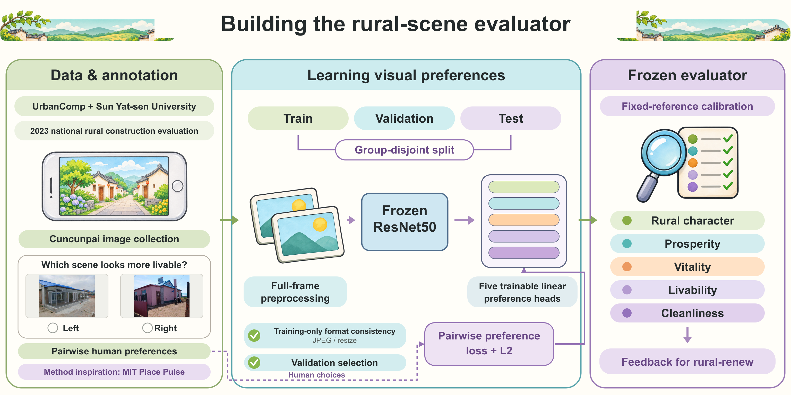

# Five-dimension rural-scene evaluator

This frozen research model supplies feedback to rural-renew. It evaluates rural character (`ft`), prosperity (`fy`), vitality (`hl`), livability (`yj`), and cleanliness (`zj`). Its predictions guide image search; they are not a substitute for human judgments of renovation feasibility.

## Construction



The research background is the village-scene evaluation work of the UrbanComp team at China University of Geosciences (Wuhan) and collaborators at Sun Yat-sen University. Their project combined Cuncunpai crowdsourced photographs collected in connection with the 2023 national rural construction evaluation initiative with human pairwise judgments of prosperity, vitality, livability, and cleanliness. See the [UrbanComp project introduction](https://urbancomp.net/archives/intelligent-interpretation-of-chinese-village). Our pairwise perceptual annotation approach draws on [MIT Place Pulse](https://www.media.mit.edu/projects/place-pulse-new/overview/). The five-dimensional labels available to this implementation also include rural character. We acknowledge the contributors to the photographs and perceptual annotations.

The current evaluator was constructed from the available images and pairwise labels as follows:

1. Match each comparison to its two images and preserve every available vote. Canonicalize pair order and aggregate both preference counts, including disagreements.
2. Group exact duplicates and identified near-duplicate photographs before making one fixed training, validation, and test split shared by all dimensions. Retain a comparison only when both images belong to the same split.
3. Use the full-frame letterbox preprocessing described below and extract features with a frozen ImageNet ResNet50. Fit feature means and scales using images involved in retained training comparisons.
4. Train one linear preference head per dimension. The probability of preferring image B is `sigmoid(s(B) − s(A))`; vote-weighted binary cross-entropy preserves the contribution of every original judgment. Only these heads are optimized; the visual backbone stays frozen.
5. Add L2 regularization and a training-image consistency term that discourages prediction changes under JPEG compression and resizing. The training variants are JPEG quality 90, half-size resizing, and double-size resizing. Select the regularization strengths separately for each dimension using the original validation comparisons.
6. Freeze the selected heads and form a fixed reference set from training-image groups. Map an image's raw predictions to mean preference probabilities against that reference set, then standardize each dimension using the fixed reference distribution.

This construction describes the packaged research evaluator. The repository supplies its inference implementation, learned heads, and calibration data.

## Run

From the repository root, after installing the project dependencies:

```bash
python -m eval_model assets/original/F03.png
```

```python
from eval_model import EvaluationScorer

scorer = EvaluationScorer()
result = scorer.score_image("assets/original/F03.png")
```

The first image evaluation loads the public ResNet50 `IMAGENET1K_V2` backbone through torchvision. If it is not cached, torchvision downloads it. The backbone is not bundled in this repository. Subsequent calls reuse the loaded model; subsequent processes use the downloaded cache.

## Frozen inference pipeline

1. Apply EXIF orientation and convert to RGB.
2. Preserve the complete image: resize its longest side to 224 pixels with bilinear interpolation, center it on a 224 × 224 canvas filled with RGB `(124, 116, 104)`, and apply ImageNet channel normalization. There is no center crop.
3. Extract 2,048 ResNet50 features. Normalize them with the saved feature means/scales and apply the five frozen linear preference heads.
4. Compare each raw prediction with the fixed set of 901 reference predictions, using the mean sigmoid difference as a reference-win probability.
5. Standardize each dimension separately as `S_d = 50 + 10 × (P_d − μ_d) / σ_d`. Combine livability and cleanliness with weights of 0.4 each; each remaining dimension has weight 1/15.

The reference distributions and all normalization parameters are fixed. Scores are not clipped. A value of 50 is a reference mean, not a pass threshold. The model identifier in the output is retained to bind the predictions to their original frozen calibration.

## Included files

| File | Purpose |
| --- | --- |
| `weights/heads.npz` | Five preference heads and feature normalization |
| `weights/reference_scores.npz` | Fixed raw reference predictions |
| `calibration/reference.json` | Per-dimension probability means, standard deviations, and percentile references |
| `calibration/objective.json` | Aggregate definition and fixed total-percentile reference |
| `evaluation-weights.json` | Dimension names and aggregation weights |
| `scorer.py` | Image preprocessing, feature extraction, and preference predictions |
| `evaluation.py` | Standardization, aggregate scores, and feedback differences |

Training caches and experimental deployment-review files are not runtime dependencies. The packaged model retains the exploratory role and numerical behavior of the original research scoring entry point.

## Regression checks

The normal test suite checks calibration, feedback, letterboxing, and EXIF orientation without downloading a backbone. To also compare inference on three included original images with their recorded frozen outputs:

```bash
RURAL_RENEW_MODEL_TESTS=1 python -m unittest discover -s tests -p test_evaluator.py
```

In PowerShell, set `$env:RURAL_RENEW_MODEL_TESTS = "1"` before running the same Python command. This optional check may download the backbone on its first run. It allows a small numerical tolerance for CPU/GPU floating-point differences.
